<div dir="rtl">

<p align="center">
  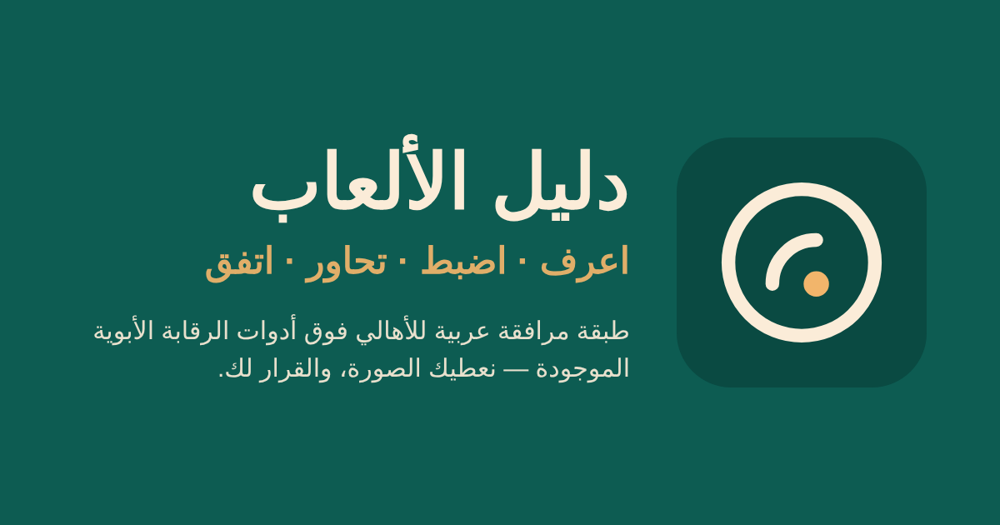
</p>

# دليل الألعاب

**طفلك يبي لعبة جديدة؟** «دليل الألعاب» طبقة مرافقة عربية فوق أدوات الرقابة الأبوية الموجودة أصلًا في كل جهاز: تعرف وش في اللعبة من مصادر رسمية، تضبط جهاز طفلك بخطوات من الدليل الرسمي، تتحاور معه، وتتفقون على بنود مكتوبة يوقّعها الطرفان.
**مو تطبيق حجب ولا مراقبة، وما يجمع أي بيانات عن الطفل.** نعطيك الصورة، والقرار لك.

<p align="center">
  <a href="https://github.com/tmrsa1-ui/dalil-alalab/actions/workflows/ci.yml"></a>
  
  
  
  
  
</p>

> مقدَّم لـ**جائزة نورة الملاحي للابتكار الاجتماعي التقني**، المسار الثاني: تعرّض الأطفال لمحتوى لا يناسب أعمارهم، وضعف فاعلية أدوات الحماية الأبوية.
>
> **قاعدة هذا الملف:** كل رقم فيه مقاس وموثق بمصدره وتاريخه. ما فيه أرقام مستخدمين ولا أثر متحقق، لأنها ما انقاست بعد. أي بيانات تجريبية في التطبيق تحمل شارة **«تجريبي»** وروابطها على `example.org`.

- 🎬 **فيديو الرحلة كاملة** (44 ثانية، بيانات حقيقية، بدون صوت): [`docs/screenshots/demo-journey.mp4`](docs/screenshots/demo-journey.mp4)
- 📋 **ملخص للمحكّمين** (الموجود مقابل الناقص، بصراحة): [`docs/JUDGES.md`](docs/JUDGES.md)
- 🔎 **التدقيق الداخلي بالدرجات** (6 جولات على 11 محورًا): [`AUDIT.md`](AUDIT.md)
- 🚀 **النشر خطوة بخطوة**: [`docs/DEPLOY.md`](docs/DEPLOY.md)

## المشكلة

- أدوات الرقابة الأبوية موجودة في iPhone وAndroid وPlayStation وXbox وSwitch، لكنها **مبعثرة** بين تطبيقات وإعدادات مختلفة، وأغلب أدلتها بالإنجليزي، فكثير من الأهالي ما يفعّلونها.
- **التصنيف العمري لحاله ما يكفي:** رقم مثل «12+» ما يقول للأب إن اللعبة فيها محادثة مع غرباء، أو صناديق حظ، أو إعلانات، أو جلسات ما تنقطع.
- **القيد بدون حوار ينكسر:** الطفل يتحايل على إعداد ما يفهمه، لكنه يلتزم أكثر ببند اتفق عليه هو بنفسه وكتبه وقّعه.

## الحل: اعرف ← اضبط ← تحاور ← اتفق

حقلان فقط في البداية: **اسم اللعبة أو التطبيق** (بحث عربي/إنجليزي يفهم «ماين كرافت» = Minecraft و«ببجي» = PUBG Mobile) و**عمر الطفل** (3–17، لا يُخزَّن في أي مكان). بعدها أربع خطوات على شاشة واحدة:

| الخطوة       | وش يشوف ولي الأمر                                                                                                                                                                                                                              | من وين المعلومة                                                                                                                                |
| ------------ | ---------------------------------------------------------------------------------------------------------------------------------------------------------------------------------------------------------------------------------------------- | ---------------------------------------------------------------------------------------------------------------------------------------------- |
| **1. اعرف**  | «الصورة باختصار» ثم التصنيفات العمرية الخمسة (التصنيف السعودي، ESRB، PEGI، App Store، Google Play) مقارنةً بعمر الطفل بهدوء، ثم **خمس نقاط انتباه ثابتة**: محادثة الغرباء، المشتريات وصناديق الحظ، نوع المحتوى، الإعلانات، مدة الجلسة والتوقف. | كل قيمة برابط مصدرها الرسمي واقتباس حرفي وتاريخ التحقق، وإلا تظهر «غير متوفر» أو «ما لقيت معلومة موثوقة». لا تخمين ولا تحويل بين جهات التصنيف. |
| **2. اضبط**  | تبويب لكل جهاز (iPhone/iPad، Android، PlayStation، Xbox، Switch، PC، وداخل اللعبة) وخطوات مرقّمة، والخطوات اللي تخص نقاط هذي اللعبة تطلع أول. كل خطوة فيها «سويتها» تنحفظ على الجهاز.                                                          | 22 خطوة لخمسة أجهزة من أدلتها الرسمية، كل خطوة باقتباس حرفي يتحقق منه السكربت آليًا.                                                           |
| **3. تحاور** | ثلاثة أسئلة مفتوحة حسب الفئة العمرية وأهم نقاط الانتباه، واحد منها دائمًا عن الأصحاب، مع «ليش هذا السؤال؟» و«إذا قال…».                                                                                                                        | بنك أسئلة مكتوب بلغة وصفية بدون وعظ ولا تخويف (`data/questions.json`).                                                                         |
| **4. اتفق**  | ولي الأمر يختار ← يسلّم الجوال لطفله (اختياراته مخفية) ← الطفل يختار بواجهة أكبر ← بنود متفق عليها أو **«بند وسط»** بقواعد ثابتة ← التزامات ولي الأمر نفسه ← **صفحة اتفاق A4** بتوقيعين وتاريخ مراجعة بعد أسبوعين (ميلادي وهجري).              | قواعد الدمج في `src/lib/agreement/merge.ts` ومختبرة. اختيارات الطفل الخام تُمسح من الذاكرة فور توليد البنود.                                   |

و**ميثاق البيت** (`/charter`): كل اتفاقات الأسرة محفوظة على الجهاز فقط، مع زر حذف.

## لقطات من التطبيق

لقطات حقيقية من نسخة البناء الحالية (بيانات حقيقية، بدون وضع تجريبي)، التُقطت آليًا بـPlaywright على مقاس Pixel 7 بتاريخ 2026-10-15 (`npm run readme:shots`). الملفات في [`docs/screenshots/`](docs/screenshots/).

<table>
  <tr>
    <td align="center" width="33%">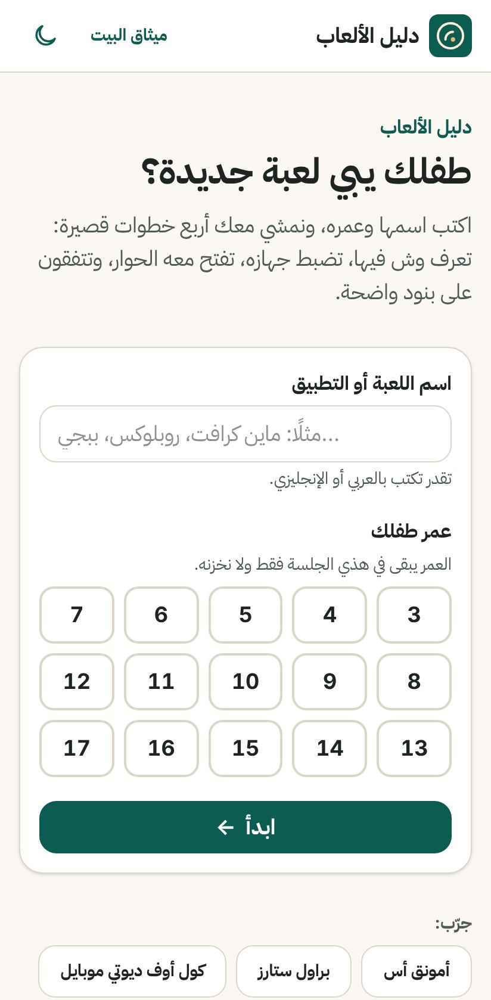<br><sub><b>الرئيسية</b>: اسم اللعبة + عمر الطفل، بدون حساب</sub></td>
    <td align="center" width="33%">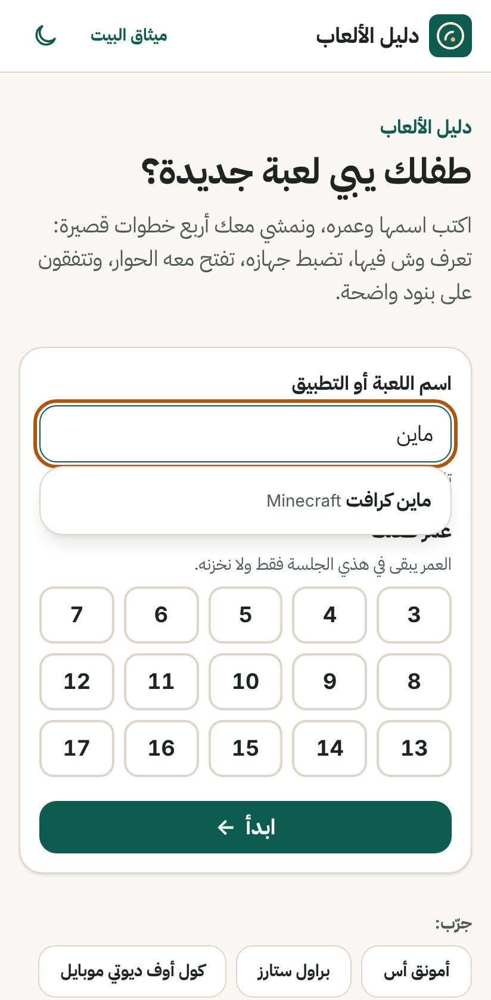<br><sub><b>البحث</b>: اقتراحات بالعربي والإنجليزي والمرادفات</sub></td>
    <td align="center" width="33%">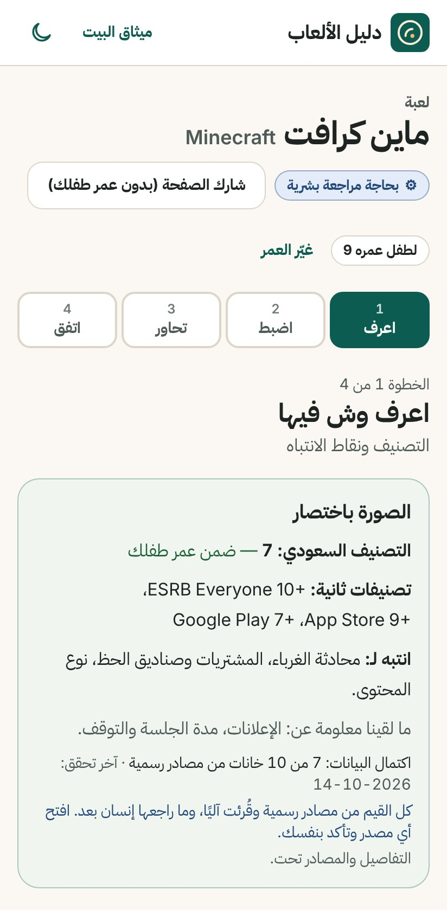<br><sub><b>اعرف</b>: «الصورة باختصار» لماين كرافت، عمر 9</sub></td>
  </tr>
  <tr>
    <td align="center">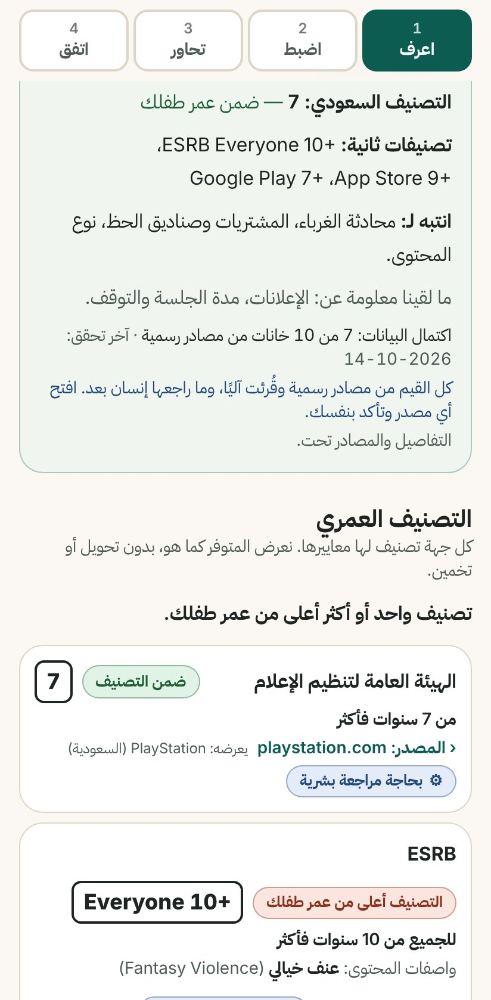<br><sub><b>اعرف</b>: التصنيفات الخمسة، كل واحد بمصدره وتاريخه</sub></td>
    <td align="center">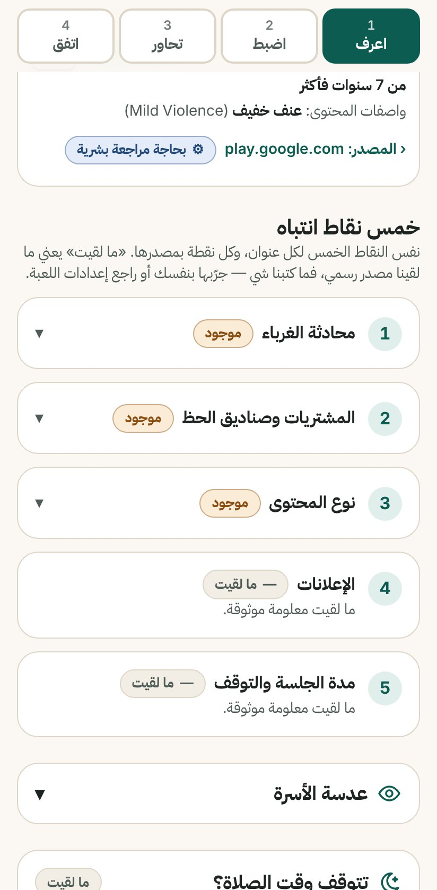<br><sub><b>اعرف</b>: نقاط الانتباه الخمس باقتباس المصدر</sub></td>
    <td align="center">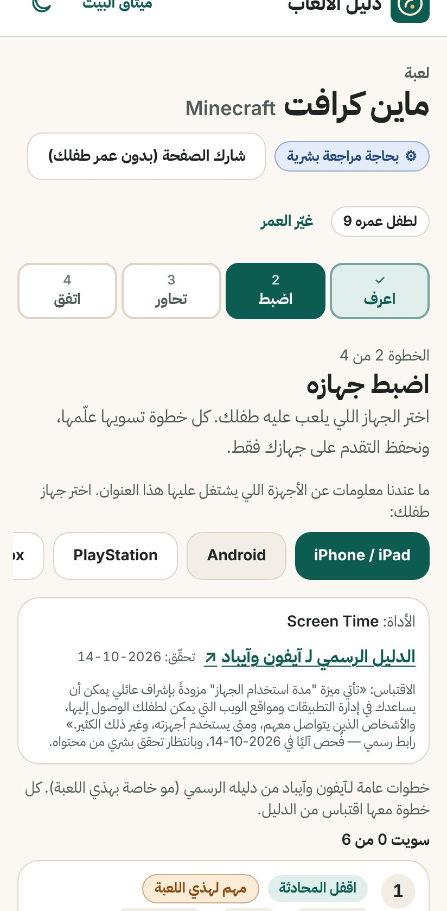<br><sub><b>اضبط</b>: خطوات كل جهاز من دليله الرسمي</sub></td>
  </tr>
  <tr>
    <td align="center">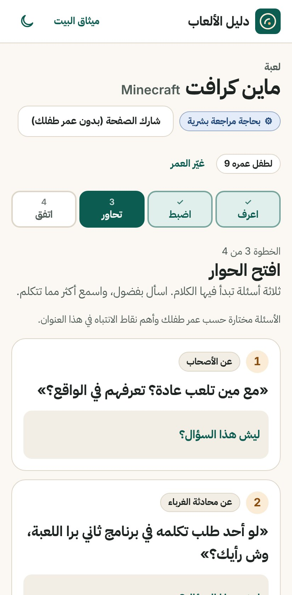<br><sub><b>تحاور</b>: ثلاثة أسئلة حسب العمر ونقاط الانتباه</sub></td>
    <td align="center">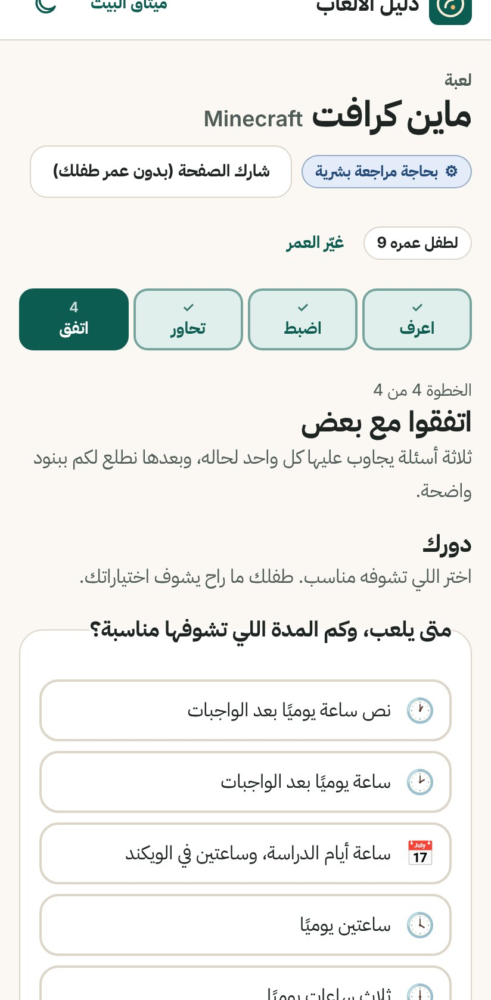<br><sub><b>اتفق</b>: اختيارات ولي الأمر</sub></td>
    <td align="center">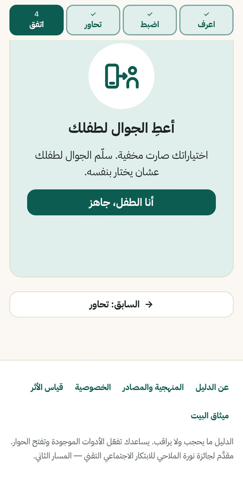<br><sub><b>اتفق</b>: تسليم الجوال للطفل (اختيارات الأب مخفية)</sub></td>
  </tr>
  <tr>
    <td align="center">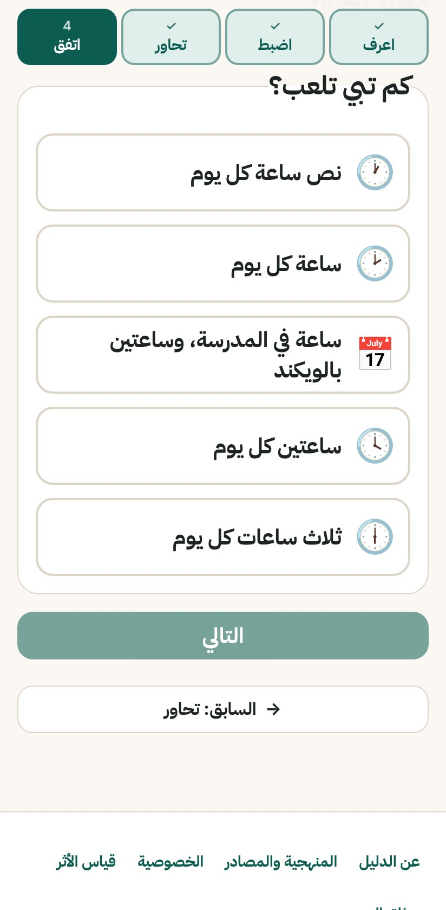<br><sub><b>اتفق</b>: الطفل يختار بلغته وبواجهة أكبر</sub></td>
    <td align="center">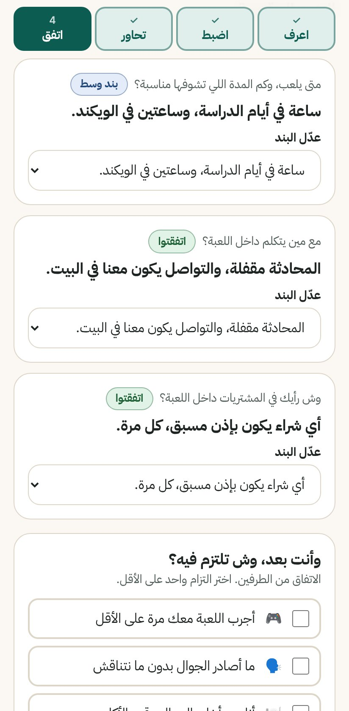<br><sub><b>اتفق</b>: «اتفقتوا» أو «بند وسط»، وكل بند قابل للتعديل</sub></td>
    <td align="center">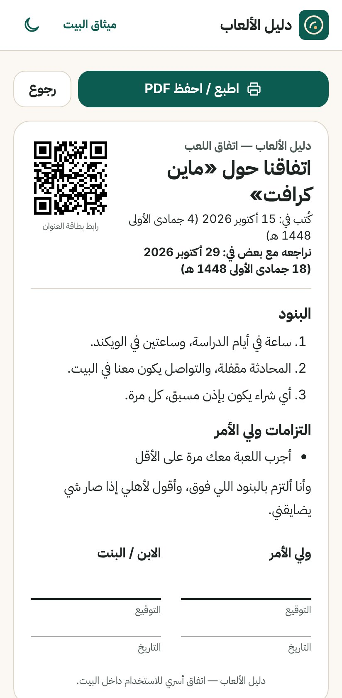<br><sub><b>الاتفاق للطباعة</b>: توقيعان وتاريخ مراجعة</sub></td>
  </tr>
  <tr>
    <td align="center">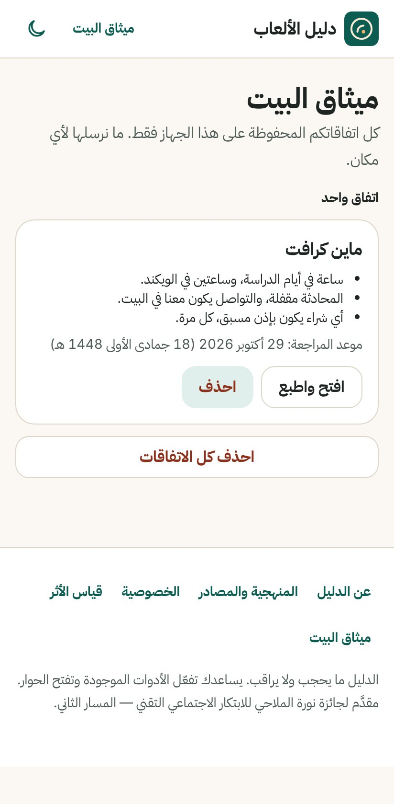<br><sub><b>ميثاق البيت</b>: محفوظ على الجهاز فقط</sub></td>
    <td align="center">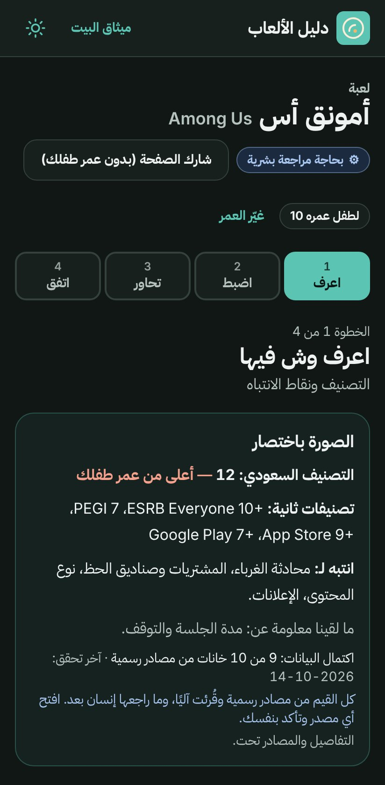<br><sub><b>الوضع الداكن</b>: Among Us، عمر 10</sub></td>
    <td align="center">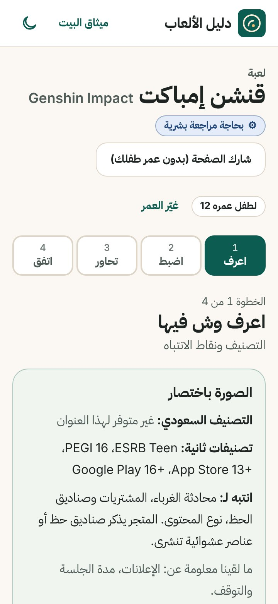<br><sub><b>أضيق شاشة (360px)</b>: بدون تمرير أفقي</sub></td>
  </tr>
</table>

<p align="center">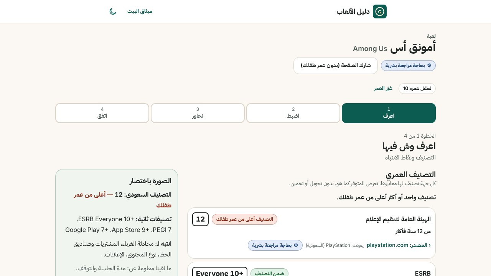<br><sub>سطح المكتب: نفس الرحلة بتخطيط عمودين</sub></p>

## ميزات للسياق السعودي

- **التصنيف السعودي أولًا:** تصنيف الهيئة العامة لتنظيم الإعلام كما تعرضه المتاجر السعودية (PlayStation وXbox وGoogle Play في السعودية)، مع ذكر الجهة اللي عرضته. موقع الهيئة نفسه ما يرد من بيئة العمل، فما نكتب شيئًا ما فتحناه.
- **عدسة الأسرة** (قسم قابل للطي): القمار أو ما يشبهه، المحادثة الصوتية مع غرباء، السحر والشعوذة، اللبس والمظهر، الموسيقى. كل بند «موجود / غير موجود / ما لقيت» مع المصدر، بلغة وصفية بدون حكم.
- **تتوقف وقت الصلاة؟** «تتوقف بسهولة / لا تتوقف أثناء المباراة / ما لقيت» مع المصدر، وتدل على أداة «وقت التوقف» في كل جهاز من دليله الرسمي، بدون مواقيت مخترعة.
- **اتفاق بتاريخ هجري وميلادي**، ولغة عربية سعودية طبيعية في كل الواجهة، RTL كامل، وخط IBM Plex Sans Arabic محلي.

## البيانات: من وين، وبأي ثقة

| البند             | الحالة (2026-10-14)                                                                                                                                                     |
| ----------------- | ----------------------------------------------------------------------------------------------------------------------------------------------------------------------- |
| العناوين الحقيقية | **20 عنوانًا** في `data/titles/` (ألعاب وتطبيقات شائعة بين الأطفال في السعودية)                                                                                         |
| مصادر التصنيف     | App Store (السعودية)، Google Play (السعودية)، PlayStation (السعودية)، متجر Xbox (السعودية)، موقع ESRB، موقع PEGI، ولكل قيمة رابط واقتباس حرفي وتاريخ                    |
| التغطية           | التصنيف السعودي **8** عناوين، ESRB **6**، PEGI **9**، App Store **19**، Google Play **15**                                                                              |
| مستوى الثقة       | كل القيم **«بحاجة مراجعة بشرية»** (آلية بمصادر). `npm run review:data` يحوّلها لـ«راجعها إنسان» قيمةً قيمة، ويمسح أي قيمة غلط بدل تصحيحها يدويًا بدون مصدر              |
| تغيّر المصادر     | قبل كل تطبيق، أي قيمة ما عاد اقتباسها في صفحتها الرسمية تُمسح ثم يُكتب ما تعرضه الصفحة اليوم. أول تشغيل التقط **4 تغييرات خلال 4 أيام** (`research/official-report.md`) |
| الناقص            | يظهر «غير متوفر» أو «ما لقيت معلومة موثوقة». لا تخمين، ولا fallback، ولا تحويل بين جهات                                                                                 |
| الكلمات الممنوعة  | «آمن/آمنة» ومشتقاتها ممنوعة في الواجهة والبيانات والكود، واختبارات آلية تفحص ذلك. نستخدم «نقاط انتباه»                                                                  |

قواعد المحتوى كاملة في [`docs/CONTENT_GUIDE.md`](docs/CONTENT_GUIDE.md)، والمنهجية في صفحة `/sources` داخل التطبيق.

## الخصوصية: لا بيانات عن الطفل

| ما نجمعه أبدًا                                                                                               | بعد موافقة صريحة فقط                                                                                                                       |
| ------------------------------------------------------------------------------------------------------------ | ------------------------------------------------------------------------------------------------------------------------------------------ |
| حساب، اسم، عمر دقيق، اختيارات الطفل، نص حر من الطفل، عنوان IP، user agent، cookies تتبع، أي تحليلات طرف ثالث | أحداث استخدام مجهولة (مثل «أكمل اتفاقًا») مع الفئة العمرية فقط (`under7` / `7to12` / `13plus`) ومعرّف جلسة عشوائي يعيش في `sessionStorage` |

- اختيارات الطفل الخام تنحذف من الذاكرة فور توليد البنود (مختبرة في unit وe2e).
- زر «امسح كل بياناتي من هذا الجهاز». لا طلبات لأي خادم قبل الموافقة (اختبار e2e يراقب الشبكة).
- سياسة أمن المحتوى (CSP) صارمة، و`Strict-Transport-Security`، ولا سكربتات طرف ثالث.
- حد الطلبات في واجهة `/api/` يستخدم بصمة مؤقتة في الذاكرة لدقيقة واحدة، ومذكور في سياسة الخصوصية.

التفاصيل: صفحة `/privacy` داخل التطبيق و[`docs/PRIVACY.md`](docs/PRIVACY.md).

## المعمارية

**المبدأ:** المنتج يشتغل كاملًا بدون أي خدمة خارجية. البيانات تُقرأ وقت البناء من ملفات JSON متحقق منها، والصفحات ثابتة، وكل شيء يخص الأسرة يبقى على جهازها.

<div dir="ltr">

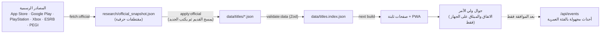

</div>

| الطبقة         | التقنية                                                                       | ليش                                                                                                |
| -------------- | ----------------------------------------------------------------------------- | -------------------------------------------------------------------------------------------------- |
| الواجهة        | Next.js 15 (App Router) · React 19 · TypeScript strict · Tailwind CSS v4      | صفحات ثابتة سريعة على الجوال، RTL بخصائص CSS منطقية                                                |
| البيانات       | Zod 4 (schemas + JSON Schema مُصدَّر) · ملفات JSON في `data/` · Fuse.js للبحث | الـschema ترفض أي تصنيف بدون `sourceUrl` و`verifiedAt`، و`validate:data` يُفشل البناء              |
| الحالة المحلية | Zustand + `localStorage`                                                      | الاتفاقات والميثاق وتقدّم «اضبط» على الجهاز فقط                                                    |
| الاختبارات     | Vitest + Testing Library · Playwright + axe-core                              | وحدة ومكونات، ورحلة كاملة على Pixel 7 وسطح المكتب مع فحص الوصولية                                  |
| اختياري        | Supabase (خلف adapter عبر REST) · Anthropic SDK (خلف `ENABLE_AI_CARDS`)       | تجميع الأحداث المجهولة وصفحة الأثر، وتوليد بطاقة «آلية بمصادر» لعنوان جديد تدخل طابور مراجعة بشرية |

<div dir="ltr">

```
data/            titles/<slug>.json (حقيقية) · demo/titles/ (تجريبية، تظهر مع DALIL_DEMO=1)
                 platforms/<id>.json · questions.json · agreement.json · titles.index.json (مولّد)
schemas/         Zod: title, platform, questions, agreement, event (+ json/ مُصدَّر)
scripts/         validate-data, build-index, fetch/apply-official, guides, review-data, audit-shots, readme-shots
src/app/         الصفحات + api/(events, generate-card, request-title)
src/components/  مكونات الواجهة (KnowGlance, PlatformTabs, TalkStep, AgreementFlow, ...)
src/lib/         normalize-ar, search, age, questions/select, agreement/merge, agent/*, events, storage, data/, i18n/ar
tests/           unit/, components/, e2e/
docs/            JUDGES, DEMO_SCRIPT, PRIVACY, DEPLOY, CONTENT_GUIDE, PILOT, EVALUATION, DECISIONS, audit/, screenshots/
```

</div>

كل قرار تصميمي مسجّل مع سببه في [`docs/DECISIONS.md`](docs/DECISIONS.md) (60 قرارًا).

## نتائج الاختبارات والجودة

كلها تمر على الالتزام الأخير، محليًا وعلى GitHub Actions ([سجل CI](https://github.com/tmrsa1-ui/dalil-alalab/actions)).

| الفحص                                                          | النتيجة                                                                                  | الدليل                                             |
| -------------------------------------------------------------- | ---------------------------------------------------------------------------------------- | -------------------------------------------------- |
| `npm run lint` · `npm run typecheck` · `npm run validate:data` | تمر                                                                                      | CI، وظيفة «lint · typecheck · data · unit · build» |
| `npm test` (Vitest)                                            | **153 اختبارًا في 24 ملفًا** تمر                                                         | محليًا 2026-10-15 وفي CI                           |
| `npm run test:e2e` (Playwright + axe)                          | **88 اختبارًا** على Pixel 7 وDesktop Chrome تمر                                          | CI، وظيفة «e2e»                                    |
| `npm run build`                                                | يمر (24 رابطًا في `sitemap.xml`)                                                         | CI                                                 |
| axe على 24 شاشة (كل مستويات WCAG 2.2 + best-practice)          | **0 مخالفات**، 0 تمرير أفقي على 360px، 0 أهداف لمس أقل من 44px                           | [`docs/audit/r6/`](docs/audit/r6/)                 |
| Lighthouse (موبايل، وسيط 3 تشغيلات)                            | الأداء **94–98**، الوصولية **100**، الممارسات **100**، SEO **100**، CLS **0**            | [`AUDIT.md`](AUDIT.md) الجولة 6                    |
| `npm audit --omit=dev`                                         | **0 ثغرات** في الإصدار الإنتاجي                                                          | 2026-10-14                                         |
| التدقيق الداخلي (تقييم ذاتي، 11 محورًا)                        | 9.32 من 10، وما يفصله عن 9.5 موثق بصراحة (مراجعة بشرية للبيانات، نشر عام، تجربة ميدانية) | [`AUDIT.md`](AUDIT.md)                             |

> **الأثر المتحقق: لم يُقَس بعد.** ما جرّبه أهالي حقيقيون حتى الآن، فما نعرض أي رقم استخدام. أدوات القياس جاهزة ومختبرة (الأحداث المجهولة، تقييم من ثلاثة أسئلة بعد الطباعة، صفحة `/about/impact`)، وخطة التجربة الميدانية في [`docs/PILOT.md`](docs/PILOT.md).

## التشغيل محليًا

يحتاج Node.js 22 (ملف `.nvmrc`). المنتج يشتغل كاملًا **بدون أي متغيرات بيئة**: لا قاعدة بيانات، ولا مفاتيح، ولا ذكاء اصطناعي.

<div dir="ltr">

```bash
git clone https://github.com/tmrsa1-ui/dalil-alalab.git
cd dalil-alalab
npm install

# الوضع التجريبي: يضيف 6 بطاقات تجريبية (شارة «تجريبي»، روابط example.org)
# فوق البيانات الحقيقية، منها بطاقة «بدون بيانات» تبيّن كيف يظهر الناقص.
DALIL_DEMO=1 npm run dev          # http://localhost:3000

# البيانات الحقيقية فقط (نفس ما تراه في اللقطات أعلاه)
npm run dev
```

</div>

للتجربة الكاملة: افتح الرابط على الجوال (أو وضع الجوال في المتصفح)، اكتب «أمونق أس» واختر عمر 10، وامشِ الخطوات الأربع حتى صفحة الاتفاق. السكربت الكامل للعرض في [`docs/DEMO_SCRIPT.md`](docs/DEMO_SCRIPT.md).

<div dir="ltr">

```bash
npm run lint && npm run typecheck && npm run test && npm run build   # فحص كامل
npm run test:e2e        # Playwright (Pixel 7 + Desktop Chrome) + axe
npm run build && npm start                                          # نسخة الإنتاج
npm run review:data     # مراجعة بشرية تفاعلية للقيم الآلية
```

</div>

| المتغير (اختياري)                            | الوظيفة                                                                                |
| -------------------------------------------- | -------------------------------------------------------------------------------------- |
| `DALIL_DEMO=1`                               | يضيف البطاقات التجريبية من `data/demo/titles/` (وقت البناء أو التطوير)                 |
| `NEXT_PUBLIC_SITE_URL`                       | الرابط العام للموقع (لروابط المشاركة وsitemap)                                         |
| `SUPABASE_URL` + `SUPABASE_SERVICE_ROLE_KEY` | تخزين الأحداث المجهولة وطلبات إضافة العناوين، وعرض الأعداد المجمّعة في `/about/impact` |
| `ENABLE_AI_CARDS=true` + `ANTHROPIC_API_KEY` | توليد بطاقة «آلية بمصادر» لعنوان غير موجود، تدخل `data/review-queue/` لمراجعة بشرية    |

القائمة الكاملة في [`.env.example`](.env.example)، وخطوات النشر على Vercel أو Docker أو Node في [`docs/DEPLOY.md`](docs/DEPLOY.md).

## خارطة الطريق

| المرحلة                   | وش فيها                                                                                                                                                                                                 | الحالة                |
| ------------------------- | ------------------------------------------------------------------------------------------------------------------------------------------------------------------------------------------------------- | --------------------- |
| **الآن**                  | المنتج كامل على الجوال، 20 عنوانًا حقيقيًا بمصادر رسمية، CI أخضر، جاهز للنشر                                                                                                                            | ✅ مكتمل              |
| **قبل التجربة الميدانية** | مراجعة بشرية للقيم العشرين (`npm run review:data`)، نشر برابط عام، جولة يدوية بقارئ الشاشة (TalkBack/VoiceOver)                                                                                         | ⏳ في يد صاحب المشروع |
| **التجربة الميدانية**     | 10–20 أسرة عبر جهة شريكة، جلسة 20 دقيقة على جوال ولي الأمر، قياس: فعّل خطوة ضبط؟ أكمل اتفاقًا؟ تكلموا خلال أسبوع؟ ([`docs/PILOT.md`](docs/PILOT.md))                                                    | 🗓️ مخطط               |
| **بعدها**                 | توسيع العناوين إلى 30–50 عنوانًا شائعًا مع مراجعة بشرية، التصنيف السعودي من موقع الهيئة عند توفره، خطوات PC/Steam، تذكير محلي بمراجعة الاتفاق، مواقيت صلاة تُحسب على الجهاز فقط، نسخة إنجليزية للمقيمين | 💡 مقترح              |

## حدود المنتج الحالية (بصراحة)

- لا حجب، لا مراقبة، لا تحكم بجهاز الطفل؛ الدليل يرافق الأدوات الموجودة ولا يستبدلها.
- كل القيم من مصادر رسمية لكن ما راجعها إنسان بعد.
- التصنيف السعودي متوفر لـ8 من 20 عنوانًا (كما تعرضه المتاجر السعودية)، لأن موقع الهيئة ما يرد من بيئة العمل.
- خطوات PC/Steam غير متوفرة بعد، وخطوات «داخل اللعبة» تظهر فقط للعناوين اللي راجعها إنسان.
- الأثر المتحقق صفر حتى تُنفَّذ التجربة الميدانية.

## للمحكّمين: جرّبوه في 3 دقائق

1. شغّلوا `DALIL_DEMO=1 npm run dev` (أو النسخة المنشورة) على الجوال.
2. اكتبوا «أمونق أس» واختاروا عمر 10: «الصورة باختصار» تقول إن التصنيف السعودي 12 أعلى من عمره، بدون حكم على اللعبة.
3. «اضبط» ← تبويب iPhone: خطوة «طلب الموافقة على الشراء» باقتباسها من دليل Apple العربي.
4. «تحاور» ثم «اتفق» حتى صفحة الاتفاق المطبوعة بتاريخ هجري وميلادي.

الوثائق: [`docs/JUDGES.md`](docs/JUDGES.md) · [`docs/DEMO_SCRIPT.md`](docs/DEMO_SCRIPT.md) · [`AUDIT.md`](AUDIT.md) · [`docs/EVALUATION.md`](docs/EVALUATION.md) · [`docs/PRIVACY.md`](docs/PRIVACY.md) · [`docs/CONTENT_GUIDE.md`](docs/CONTENT_GUIDE.md) · [`docs/DECISIONS.md`](docs/DECISIONS.md) · [`docs/DEPLOY.md`](docs/DEPLOY.md) · [`CHANGELOG.md`](CHANGELOG.md)

## الترخيص

الكود: MIT ([`LICENSE`](LICENSE)). الخط: IBM Plex Sans Arabic برخصة SIL OFL (`src/fonts/LICENSE-OFL.txt`). التصنيفات والاقتباسات ملك جهاتها، وتُعرض مع رابط مصدرها.

</div>

---

<details>
<summary><b>English summary</b></summary>

**Dalil Al-Alab** (“The Games Guide”) is an Arabic, mobile-first companion layer on top of the parental controls families already have. A parent types a game or app name and the child's age, then walks four steps on one screen: **Know** (five age ratings and five attention points, each with an official source, a verbatim quote and a verification date, or an explicit “not available”), **Set up** (numbered parental-control steps per device, taken from the official guides and ordered by what matters for this title), **Talk** (three age-appropriate conversation questions), and **Agree** (a parent–child agreement with a midpoint clause, printed with two signatures and a review date). No blocking, no monitoring, and no data about the child is ever collected. Built with Next.js 15, TypeScript strict and Zod 4; runs fully without any external service. 20 real titles with sources from the Saudi App Store, Google Play, PlayStation and Xbox stores, ESRB and PEGI. 153 unit/component tests and 88 Playwright + axe end-to-end tests run in CI. Submitted to the Noura Al-Mallahi Award for Social Technological Innovation, track 2. Verified impact has not been measured yet; the pilot plan is in `docs/PILOT.md`.

</details>
